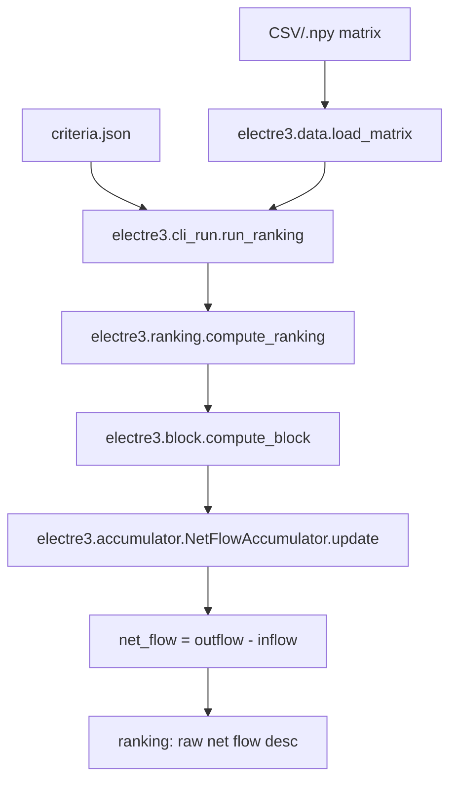

# CLI Quickstart (CSV → ELECTRE III net‑flow ranking)

This tutorial shows how to run the project’s ranking pipeline from the command line using a CSV matrix and a criteria JSON file.

**What you get:** a deterministic net-flow score for each alternative, and a ranking by **raw net flow (descending)**. If two alternatives have equal net flow, their relative order is not guaranteed by the current implementation.

## Prerequisites

Run commands from the **repo root** (the directory that contains `electre3/`, `app/`, `docs/`, `tests/`).

## Data contract (inputs)

### Matrix

A matrix `G` with shape **(N, C)**:
- `N` = number of alternatives (rows)
- `C` = number of criteria (columns)

Accepted formats:
- `.csv` — numeric-only (no header row, no ID column) when using `electre3.data.load_matrix`.
- `.npy` / `.npz` — NumPy arrays (recommended once converted).

Constraints:
- Values must be numeric and finite.
- `electre3.data.load_matrix` loads CSV values as `float64`.
- `electre3.validate.validate_matrix` enforces: 2-D shape, N≥2, C matches number of criteria, and finite values.
- Column order must match the order of criteria in your criteria JSON.

### Criteria JSON

A JSON **list** of length **C**. Each element describes one criterion:
- `name` (string)
- `weight` (float, must be > 0)
- `q`, `p`, `v` (floats, must satisfy **0 ≤ q ≤ p ≤ v**)
- `maximize` (bool; set `false` for cost criteria)

The CLI reads this file and constructs `CriterionConfig` objects.

## Dependency map (pipeline)

### Chosen
- Mermaid flowchart — Lightweight, readable, supported by GitHub and many doc renderers.

### Near-miss
- Graphviz DOT — Precise, but needs rendering tooling.
- ASCII box diagram — Always works, but harder to maintain.



Fallback (plaintext):
- Load matrix → validate thresholds and matrix → build blocks → compute S blocks → accumulate O(N) flows → sort by raw net flow.

Blockwise detail:
- Pairwise intermediates: `diff`, `c_j`, `d_j` have shape (B1, B2, C).
- Credibility block: `S_block` has shape (B1, B2).
- Accumulator keeps two length-N vectors (`outflow`, `inflow`) for O(N) storage.

## Step 1 — Prepare inputs

### Option A: already-clean numeric CSV

If your CSV has **no headers** and **no ID column**, you can run the CLI directly.

### Option B: real-world CSV (header and/or ID column)

Use the converter to produce a strict numeric `.npy` matrix.

Example:
```bash
python scripts/convert_matrix_csv.py in.csv out/matrix.npy --has-header --id-col Asset
```

Notes:
- `--id-col` accepts a header name (when `--has-header`) or a 0-based index.
- Empty cells are rejected by default. Use `--fill-empty 0` only if that is valid for your model.

## Step 2 — Run the CLI

### Run (with preview + confirmation)

```bash
python -m electre3.cli out/matrix.npy criteria.json -b 1000
```

- The CLI prints a preview and asks `Proceed? [y/N]`.
- Use `-b/--block-size` to control blockwise memory.

### Run non-interactively

```bash
python -m electre3.cli out/matrix.npy criteria.json -b 1000 -y
```

### Save output

```bash
python -m electre3.cli out/matrix.npy criteria.json -b 1000 -y -o out/ranking.npy
```

Output contract:
- The CLI prints the top-ranked alternatives as **indices** (`Alt 0`, `Alt 1`, …).
- Saved output is a NumPy array of indices ordered best → worst.

## How to interpret results

Net flow is computed from credibility values **S(a,b)**, where **a** and **b** are alternative objects and S(a,b) is the credibility of “a outranks b”. In blockwise computation, block rows and columns are comparison groups of alternatives.

Definitions (diagonal excluded):
- outgoing flow φ⁺(a) = Σ_b S(a,b)
- incoming flow φ⁻(a) = Σ_b S(b,a)
- net flow φ(a) = φ⁺(a) − φ⁻(a)

Diagonal handling:
- The pipeline clears self-comparisons by setting S(a,a)=0 in diagonal blocks (`compute_block(..., is_diagonal=True)`).

This project ranks by **raw** φ(a) (descending). Equal φ values indicate ties in the net-flow score.

## References (repo links)

- CLI entrypoint: `electre3/cli.py`
- CSV/NumPy loader: `electre3/data.py` (`load_matrix`)
- CSV converter: `scripts/convert_matrix_csv.py`
- CLI runner: `electre3/cli_run.py` (`run_ranking`, `format_preview`)
- Ranking pipeline: `electre3/ranking.py` (`compute_ranking`)
- Block computation: `electre3/block.py` (`compute_block`)
- Accumulator: `electre3/accumulator.py` (`NetFlowAccumulator`)
- Debugging playbook: `docs/runbook/debugging.md`
- Runbook architecture: `docs/runbook/architecture.md`
- Runbook dependencies: `docs/runbook/dependencies.md`
